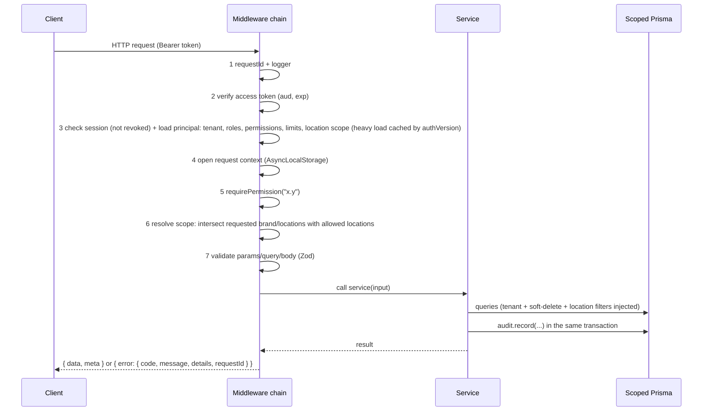

# Restoflux: Architecture

> **Status:** Phase 0 draft, awaiting review. **Last updated:** 2026-11-09.
> Read [PRODUCT_SPEC.md](PRODUCT_SPEC.md) first for the *what*; this document is the *how*. Entities are in [DATA_MODEL.md](DATA_MODEL.md); open choices are in [DECISIONS.md](DECISIONS.md) (referenced as **D#**).
> Laravel comparisons are marked *(Laravel: ...)* because the goal is that you can explain every decision in an interview.

## 1. Guiding principles

1. **Keep the stack.** Node 22+, Express 5, TypeScript (ESM), Prisma 7 on Neon Postgres, Zod, Vitest + Supertest, React + Vite + Tailwind + react-router. New in the admin app: shadcn/ui, TanStack Query, TanStack Table, react-hook-form, Zod, Recharts.
2. **Boring and explicit beats clever.** Plain functions and modules, no DI container, no decorators, no ORM magic that hides a query. If a rule matters (tenant scoping, permissions, audit), it lives in **one** place and is **tested**.
3. **Fail closed.** No tenant context means an error, not "all rows". No permission mapping means deny. No threshold row means "needs approval".
4. **Ledgers over mutable totals** for stock, cash, loyalty and audit: append-only rows are the truth; balances are derived or maintained transactionally.
5. **Pure core, thin edges.** Money, tax, units, costing, price resolution and approval policy are pure functions with no database, so they can be tested exhaustively.
6. **Strangler migration.** Every phase leaves the existing storefront working; old code is removed only after its replacement is live and reconciled.

## 2. Repository layout

npm **workspaces** at the repo root (Decision **D9**). `web/` stays where it is (it remains the customer storefront); the new admin app is a sibling.

```
restaurant-ordering/
├── package.json                 workspaces: api, web, admin, packages/*
├── docs/                        this documentation set
├── packages/
│   └── contracts/               shared by api, admin and web
│       └── src/
│           ├── permissions.ts   the permission catalog (single source of truth)
│           ├── enums.ts         order types, statuses, reason types, ...
│           ├── money.ts         format / parse / allocate helpers (pure)
│           ├── schemas/         Zod request/response schemas per module
│           └── index.ts
├── api/                         Express + Prisma
├── web/                         customer storefront (existing, evolves)
└── admin/                       NEW: management app (shadcn/ui), includes POS and KDS screens
```

*(Laravel: a monorepo with a shared package is like extracting a common composer package used by several apps, so validation rules and the permission list exist once.)*

### 2.1 API layout (`api/`)

```
api/
├── prisma/
│   ├── schema/                  multi-file schema, one file per module
│   │   ├── _base.prisma         generator, datasource, shared enums
│   │   ├── org.prisma  iam.prisma  catalog.prisma  orders.prisma
│   │   ├── inventory.prisma  purchasing.prisma  crm.prisma
│   │   ├── delivery.prisma  staff.prisma  reporting.prisma
│   │   └── legacy.prisma        old tables during migration (deleted by Phase 3)
│   ├── migrations/
│   └── sql/                     hand-written SQL fragments (partial unique indexes, CHECKs)
├── scripts/                     create-tenant, seed, reset-demo, purge-tenant
├── src/
│   ├── server.ts  app.ts
│   ├── core/                    cross-cutting, no business rules
│   │   ├── config/              env validation (Zod)
│   │   ├── context/             AsyncLocalStorage request context
│   │   ├── db/                  scoped client (tenant + soft delete + location), unscoped client
│   │   ├── auth/                tokens, sessions, passwords, PINs
│   │   ├── rbac/                requirePermission, principal loading, policy (thresholds)
│   │   ├── audit/               audit.record()
│   │   ├── http/                envelope, errors, pagination, sorting, filters, validate()
│   │   ├── events/              in-transaction domain events
│   │   ├── money/  tax/  time/  units/  costing/   pure modules
│   │   └── jobs/                queue adapters (Upstash QStash), signed job endpoints
│   ├── modules/                 one folder per business module (section 3)
│   │   └── <module>/
│   │       ├── routes.ts        thin: parse, authorize, call service, respond
│   │       ├── service.ts       business rules, transactions, audit
│   │       ├── schemas.ts       re-exports from contracts + module-private schemas
│   │       ├── permissions.ts   which permissions each route needs
│   │       ├── events.ts        events this module emits/handles
│   │       ├── index.ts         the module's PUBLIC API (other modules import only this)
│   │       └── *.test.ts        or under api/tests/<module>/
│   └── legacy/                  compatibility routes for the old storefront (deleted by Phase 3)
└── tests/
```

*(Laravel: `routes.ts` is a controller + route file, `service.ts` is a service/action class, `schemas.ts` is a FormRequest, `permissions.ts` is the route's policy/gate, `events.ts` is Event/Listener.)*

### 2.2 Admin app layout (`admin/`)

```
admin/src/
├── app/                         router, providers, shell
│   ├── shell/                   Sidebar, Topbar, ScopeSwitcher, DateRange, CommandSearch, Notifications, UserMenu
│   └── nav.config.ts            sidebar tree with required permissions
├── components/
│   ├── ui/                      shadcn/ui components (generated, owned by us)
│   ├── data-table/              TanStack Table wrapper (search, filters, sort, columns, pagination, export)
│   ├── page/                    PageHeader (title, breadcrumbs, action), EmptyState, ErrorState, Skeletons
│   └── form/                    react-hook-form field components (Input, Select, MoneyInput, DatePicker ...)
├── features/<module>/           pages, columns, forms, query hooks per module
├── pos/  kds/                   full-screen touch layouts (no sidebar)
├── lib/                         api client, auth, permissions (can()), format, query client, i18n
└── main.tsx
```

## 3. Backend modules and boundaries

| Layer | Modules | May depend on |
|---|---|---|
| **L0 core** | context, db, auth, rbac, audit, http, events, money, tax, time, units, costing | nothing in `modules/` |
| **L1 foundation** | `org` (tenant, brands, locations, tax, payment methods, tables, stations), `iam` (users, roles, sessions, approvals), `audit-viewer`, `notifications` | L0 |
| **L2 master data** | `catalog` (products, modifiers, combos, menus), `pricing` (price books, resolution), `customers`, `suppliers`, `staff` | L0, L1 |
| **L3 transactions** | `orders` (orders, payments, discounts, refunds), `pos` (shifts, cash drawer, Z-report), `kds`, `delivery` | L0 to L2 |
| **L4 supply chain** | `inventory` (items, recipes, ledger, counts, transfers, production), `purchasing` | L0 to L3 |
| **L5 insight** | `reports`, `dashboard` | everything (read-only) |
| **edge** | `public` (storefront API), `legacy` | any, but contains no business rules |

**Rules**
1. Dependencies point **down** the table. A module imports another module only through its `index.ts`.
2. Upward effects use **in-transaction domain events** (`core/events`). Example: `orders` emits `order.completed`; `inventory` registers a handler that posts stock movements **inside the same database transaction**, so a completed order and its stock deduction commit or roll back together.
3. Routes never touch Prisma directly; services do. Reports are the one place allowed to use raw SQL (section 12).
4. Enforced by ESLint (`no-restricted-imports`, boundaries rule) from Phase 1.

```mermaid
flowchart TD
  core[L0 core] --> org[L1 org / iam / notifications]
  org --> master[L2 catalog / pricing / customers / suppliers / staff]
  master --> tx[L3 orders / pos / kds / delivery]
  tx --> supply[L4 inventory / purchasing]
  supply --> insight[L5 reports / dashboard]
  tx -. order.completed event .-> supply
```

## 4. Request lifecycle



Unauthenticated routes (login, storefront `public/*`) skip steps 2 to 5 but still run with a tenant context resolved from the brand slug (section 5.5).

## 5. Multi-tenancy

*(Laravel: a single-database tenancy package such as stancl/tenancy's "single database" mode, or a global scope on every model.)*

### 5.1 Model
`Tenant → Brand → Location(type BRANCH | WAREHOUSE | CENTRAL_KITCHEN)`. **One shared database, one schema.** Every business table has a non-null `tenantId`; branch-level tables also have `locationId`. Reference data that is the same for everyone (currencies) has no `tenantId` and is read-only.

### 5.2 The one enforcement point
A **Prisma client extension** wraps every model operation. It reads the current request context (tenant, location scope) from `AsyncLocalStorage` and rewrites the query:

```ts
// core/db/scoped.ts (sketch)
export const db = basePrisma.$extends({
  query: {
    $allModels: {
      async $allOperations({ model, operation, args, query }) {
        const meta = modelMeta[model];              // generated from Prisma DMMF at startup
        if (!meta.tenantScoped) return query(args); // currencies etc.
        const ctx = requireContext();               // throws if there is no tenant context
        args = injectTenant(args, operation, ctx.tenantId);        // where.tenantId / data.tenantId
        if (meta.softDelete)  args = hideDeleted(args, operation);  // where.deletedAt = null
        if (meta.locationScoped && !ctx.allLocations)
          args = limitToLocations(args, operation, ctx.locationIds); // where.locationId in (...)
        return query(args);
      },
    },
  },
});
```

- `modelMeta` is **generated from the schema** (any model with a `tenantId` field is tenant-scoped; `deletedAt` means soft-delete; `locationId` means location-scoped), so adding a model cannot silently skip scoping.
- **Creates** get `tenantId` from the context; a client-supplied `tenantId` is overwritten. Nested creates must set `tenantId` explicitly; a missing one fails on the `NOT NULL` constraint (fail closed).
- `findUnique/update/delete` receive the extra `tenantId` condition (Prisma "extended where unique").
- Two clients are exported: `db` (scoped, the default) and `unscopedDb`, which can only be imported by `core/auth` (login lookup), migrations, seeds and the tenant purge script. ESLint forbids importing it elsewhere.

### 5.3 Defense in depth (Decision **D3**)
1. **Automated coverage test:** reads the Prisma DMMF and fails if any model is neither tenant-scoped nor on an explicit allow-list.
2. **Leak tests:** for every list/detail endpoint, create data in two tenants and assert tenant B never sees tenant A's rows (table-driven, generated from the route registry).
3. **Composite foreign keys on critical relations** (`(tenantId, parentId) → (tenantId, id)`) so a child can never point at another tenant's parent, even through a bug.
4. **Raw SQL rule:** `$queryRaw` is allowed only in `modules/reports/**` and `modules/inventory/ledger.ts`, always through `scopeSql(ctx)` which emits the tenant and location predicates; a test greps those files for the helper.
5. **Optional (recommended after Phase 1): Postgres Row-Level Security** keyed on `SET LOCAL app.tenant_id` per transaction. It is the strongest guarantee but needs every request wrapped in a transaction and care with Neon's pooler, so it is a deliberate later hardening step.

### 5.4 Location (branch) scoping
The principal carries `allLocations: boolean` and `locationIds: string[]` (from `UserLocation`). The extension limits location-scoped models to that set. Requested filters (`?brandId=`, `?locationIds=`) are **intersected** with the allowed set, never trusted. Operations that act on one place (POS, receiving) require an explicit `locationId` that must be inside the allowed set.

### 5.5 Where the tenant comes from
| Caller | Source |
|---|---|
| Staff (admin/POS/KDS) | The user's `tenantId`, via the access token and session |
| Storefront (public, anonymous) | The brand slug in the URL (`/api/v1/public/brands/:slug/...`) resolves brand → tenant; dev fallback `DEFAULT_BRAND_SLUG` |
| Customers (logged in) | Token with `aud: "customer"` and the same tenant |
| Jobs, seeds, scripts | `runAsTenant(tenantId, fn)` opens a context explicitly |

## 6. Authentication and sessions (Decision **D11**)

- **Access token:** JWT, 15 minutes, kept in memory by the SPA. Claims: `sub` (user id), `tid` (tenant), `sid` (session id), `aud` (`staff` or `customer`). It does **not** carry roles or permissions.
- **Refresh token:** random, 30 days, **rotated on every use**, stored hashed in `Session`, delivered as an `HttpOnly; Secure; SameSite` cookie. Serving the admin app and the API on the same site (Vercel rewrites `/api` to the API project) keeps the cookie first-party.
- **Why not roles in the JWT:** the current JWT carries the role, so demotions only apply when the token expires. Here, every request runs **one indexed query** that returns the session's revoked flag and the current `authVersion` values (user and tenant). The expensive part, the **principal** (roles, permissions, limits, locations), is loaded once per version and cached in process, keyed by `(userId, authVersion)`. Any role, permission, branch-access or status change bumps `authVersion`, so the very next request sees it, at the cost of one small query per request (the session check is needed for revocation anyway).
- **Login history and revocation:** every login attempt writes `LoginEvent`; `Session` rows can be revoked (logout, "sign out everywhere", user deactivation).
- **POS PIN:** a separate, bcrypt-hashed numeric PIN for fast cashier login and manager override, with lockout after repeated failures. A PIN proves identity; permissions still come from roles.
- Passwords: bcrypt (existing), min 12 characters for roles with financial permissions, rate limiting on login, refresh and PIN endpoints.

## 7. Authorization (RBAC)

### 7.1 Concepts
| Concept | Where it lives |
|---|---|
| **Permission catalog** (`module.action`) | `packages/contracts/src/permissions.ts`, a typed const; used by API, admin, tests |
| **Role** (tenant-defined) | `Role`, with `RolePermission(roleId, permission)`; seeded defaults per tenant, editable |
| **User ↔ Role** | many-to-many (`UserRole`); permissions are the **union** |
| **User ↔ Locations** | `UserLocation` plus a user flag `allLocations` |
| **Thresholds** | `Role.maxDiscountPercent` and `RoleLimit(roleId, currency, voidLimitMinor, refundLimitMinor, poApprovalLimitMinor, adjustmentLimitMinor)`; effective limit = max across the user's roles |

Permission strings live in code (validated by Zod against the catalog), not in a table: no sync problem, and the matrix UI reads the catalog from the API.

### 7.2 Enforcement layers
1. **Route gate:** `router.post("/orders/:id/void", requirePermission("orders.void"), handler)`. A route without a gate fails a startup check (a registry test lists routes and their permissions).
2. **Data scope:** tenant + location filters in the scoped client (section 5).
3. **Policy checks in services:** thresholds and business conditions, via a pure `policy` module:
   `policy.discount(principal, percent)`, `policy.void(principal, amountMinor, currency)`, and so on, each returning `allowed` or `requiresApproval`.
4. **Approval workflow** (section 7.3).
5. **UI gating:** `/auth/me` returns `permissions`, `locationIds`, `limits`. The admin hides nav items and buttons with `can("x.y")`; the backend still re-checks everything.

### 7.3 Approvals
```
requester calls action ──► policy says "requires approval"
        │                         │
        │            ┌────────────┴─────────────┐
        │            ▼                          ▼
        │   inline override                async request
        │   (manager enters PIN)           (ApprovalRequest, status PENDING,
        │   → approval recorded APPROVED    manager decides in the inbox)
        │            └────────────┬─────────────┘
        ▼                         ▼
 requester RETRIES the action with approvalId
 service verifies: approval matches this action + amount hash, unused, not expired,
 approver holds the permission AND the amount is within the approver's limit
 → executes, marks the approval consumed, writes audit rows (requester and approver)
```
The service returns `403 APPROVAL_REQUIRED` with the options when no valid approval is supplied. Retry-with-`approvalId` was chosen over "store the command and execute it on approval" because it is simple, avoids executing stale commands, and leaves one clear audit story. Approvals cover: voids, refunds, over-limit discounts, over-limit stock adjustments, purchase orders, count approval, transfers.

## 8. Audit log

- Table `AuditLog` (append-only): `tenantId, locationId?, actorUserId?, actorType (USER | SYSTEM | CUSTOMER), action ("orders.void"), entityType, entityId, before JSONB, after JSONB, reason?, requestId, ip, userAgent, occurredAt`.
- **Written explicitly by services** with `audit.record(tx, {...})` **inside the same transaction** as the change (Decision **D12**: explicit calls rather than automatic model hooks, because we want intentional, meaningful records and clear before/after, and we can test each one). Context (actor, tenant, request id, IP) is filled in automatically.
- `before/after` are whitelisted snapshots (never password hashes, PINs, tokens).
- Immutability: the app role has no `UPDATE`/`DELETE` grant on `audit_logs` where the platform allows; otherwise a trigger rejects them. Indexed by `(tenantId, occurredAt desc)`, `(tenantId, entityType, entityId)`, `(tenantId, actorUserId, occurredAt)`; monthly partitioning later if volume demands.
- Every "sensitive action" in the spec has a test asserting its audit row.

## 9. API conventions

| Topic | Convention |
|---|---|
| **Base path** | `/api/v1/...`; the old `/api/...` routes live in `legacy/` until Phase 3 |
| **Resources** | plural kebab-case: `/products`, `/purchase-orders`; actions as sub-resources: `POST /orders/:id/void` |
| **Success** | `{ "data": ..., "meta"?: ... }` |
| **Lists (offset)** | `?page=1&pageSize=25` → `meta: { page, pageSize, total }` (admin tables) |
| **Lists (cursor)** | `?cursor=...&limit=50` → `meta: { nextCursor }` (audit log, stock movements, orders, notifications) |
| **Sorting** | `?sort=-createdAt,name`; each endpoint declares an allow-list |
| **Filtering** | explicit query params validated by Zod (`?status=OPEN&locationIds=a,b&from=2026-01-01&to=2026-01-31&q=burger`) |
| **Errors** | `{ "error": { "code", "message", "details"?, "requestId" } }` |
| **Error codes** | `VALIDATION_ERROR` 422, `UNAUTHENTICATED` 401, `FORBIDDEN` 403, `APPROVAL_REQUIRED` 403, `NOT_FOUND` 404 (also for other tenants' ids), `CONFLICT` 409, `RATE_LIMITED` 429, `INTERNAL` 500 |
| **IDs** | UUIDv7 strings (Decision **D2**). Offline-capable entities accept a client-generated id; a repeat with the same id returns the existing record (natural idempotency) |
| **Money in JSON** | amounts: integer minor units + `currency` (`{ "amountMinor": 129900, "currency": "PKR" }`); quantities/rates/unit costs: **decimal strings** (`"0.125"`) |
| **Dates** | ISO 8601 UTC instants; business dates as `YYYY-MM-DD` |
| **Soft delete** | `DELETE` archives (`deletedAt`); `?includeArchived=true` for admins; restore via `POST /:id/restore` |
| **Validation** | Zod schemas from `packages/contracts`, applied by a `validate({ params, query, body })` helper |
| **Rate limiting** | auth, refresh, PIN, approval and public endpoints |

The **error format change** (from `{ error: "text" }`) is breaking for the storefront and is handled in Phase 1 (Decision **D10**).

## 10. Money, tax, time and units (pure core modules)

### 10.1 Money (Decision **D1**)
- **Amounts of money** are integers in **minor units** with a currency code. The `Currency` table gives the exponent (PKR/AED/USD = 2, KWD = 3, JPY = 0). Transactional rows carry a denormalized `currencyCode` (copied from the location) so a row is self-describing.
- **Rates and measures** are `Decimal` (Prisma `Decimal` / decimal.js, serialized as strings): quantities, unit costs (for example Rs 0.012 per gram), tax rates, percentages.
- **Where they meet:** unit cost × quantity gives a Decimal that is rounded to minor units **once, at a defined posting point** (for example when a sale posts COGS), using half-up rounding; the rounding point is documented per module.
- `core/money` offers: `add/sub/mul(minor, ratio)`, `roundHalfUp`, `allocate(total, weights)` (largest-remainder so parts always sum to the total, used for discounts and split bills), `format(minor, currency, locale)`, `parse(string, currency)`. Floats never appear; a lint rule forbids `parseFloat`/`Number()` on money fields.

### 10.2 Tax
- Config: `TaxProfile` (inclusive or exclusive prices) → `TaxRule`s (name, authority, rate, compound, applies to tax category and order type).
- Per **line**: `net`, then each applicable rule.
  - **Exclusive:** `tax = round(base × rate)`; compound rules use the running base.
  - **Inclusive:** `tax = gross − round(gross ÷ (1 + rate))` (for several non-compound rules, `÷ (1 + sum of rates)` is split proportionally).
  - **Discounts** are allocated to lines first (`allocate`), then tax is computed on the discounted base.
- Stored per line in `OrderLineTax` (rule name, authority, rate, base, tax). The order total is the sum of lines. Golden-file tests per tax profile and receipt.
- **Deferred (Decision D14):** tax that depends on the payment method (some provinces rate card vs cash differently) needs tax recomputed at payment time; fiscal/government invoice integrations (for example FBR in Pakistan) get a port interface only.

### 10.3 Time
Instants are `timestamptz` UTC. Each location has an IANA timezone and a business-day start time; `core/time` converts an instant to a **business date** (`businessDateOf(instant, location)`), which is stored on orders, payments, shifts and movements and used by all reports. Opening hours are evaluated in the location's timezone. The server never uses its own local timezone.

### 10.4 Units
Every inventory item has a **base unit** from a dimension (weight → g, volume → ml, count → piece). Conversions: global (kg→g) plus **per-item packaging** (case = 24 pieces, sack = 25 kg). Recipes and counts accept any convertible unit and normalize to the base unit with Decimal arithmetic.

## 11. Orders, stock and cash: transaction design

### 11.1 Order creation and completion
- `POST /orders` takes a **client-generated UUID**, `locationId`, channel, order type, lines (variant, quantity, modifiers) and discounts. The service resolves prices (section 11.3), computes tax and totals, snapshots everything, and stores the order with `businessDate`. A repeat of the same id returns the stored order.
- Status changes go through a state machine with **compare-and-set** updates (as today): `UPDATE ... WHERE id = ? AND status = <expected>`.
- **On `COMPLETED`, in one transaction:** payments must cover the total (or the order is flagged as unpaid per configuration), the `order.completed` event fires, and the inventory handler posts one `SALE_CONSUMPTION` movement per ingredient (recipe explosion with yield and modifier usage), updating on-hand and average cost, and raises low-stock notifications. If anything fails, the order does not complete.
- **Voids/refunds after completion** post compensating movements (return to stock only when the item was not prepared; otherwise logged as waste).

### 11.2 Stock ledger concurrency
`StockMovement` rows are append-only. `StockLevel(locationId, itemId)` holds on-hand and average cost and is updated with **atomic SQL** inside the transaction (`UPDATE ... SET on_hand = on_hand + :q, avg_cost = ... RETURNING`, the weighted-average formula computed from the row's own prior values). This avoids read-modify-write races under parallel orders. Parallel-issue tests assert the final on-hand equals the sum of movements.

### 11.3 Price resolution
Pure function over candidate rows: `branch+channel → branch → price book+channel → price book`, first match wins, filtered by validity window and menu schedule. No match = not sellable.

### 11.4 Cash drawer
`CashShift` opens with a float; every cash payment, refund, `CashMovement` (cash in, cash out, paid-out, safe drop) is linked to the shift. Closing computes `expected = float + cash sales − cash refunds + in − out − drops`, stores `counted` and `variance`, and generates the `ZReport` snapshot (immutable JSON). A cash variance beyond the tenant's tolerance creates a notification and an audit row.

### 11.5 Food cost model (the heart of problem 1)
```
Theoretical usage  = Σ (units sold × recipe quantity)                   from SALE_CONSUMPTION movements
Logged waste       = Σ WASTE / EXPIRY / STAFF_MEAL / DAMAGE / THEFT adjustments
Unexplained loss   = − Σ COUNT_VARIANCE movements                       (counted − system expected)
Actual usage       = Theoretical + Logged waste + Unexplained loss
Variance %         = (Actual cost − Theoretical cost) ÷ Theoretical cost    (per item, per branch)
```
All valued at average cost at the time of each movement (each movement stores `unitCost`). This identity is unit-tested end to end. Counts are the only thing that reveals unexplained loss, which is why the product pushes scheduled and cycle counts (high-value items counted more often).

## 12. Reporting architecture

- Reports are **read-only queries** in `modules/reports/<report>/`, each exposing `query(params, ctx)` and a column definition shared by the screen, CSV and PDF.
- Phase 6 starts with **indexed SQL aggregations** (`(tenantId, locationId, businessDate)` indexes) over the ledgers; if the 90-day seed misses the performance budget, add **rollup tables** (`DailySalesSummary`, `StockSnapshot`) maintained in the same transaction as the source writes.
- Raw SQL goes through `scopeSql(ctx)` (section 5.3). Multi-currency scopes return **one block per currency** unless a reporting currency is chosen, which converts with `FxRate` (manually maintained; Decision **D18**).
- **Export:** CSV streamed; PDF generated server-side with a pure-Node library (no headless browser, to fit serverless limits; Decision **D15**).
- **Alerts** (low stock, high variance, pending approvals, cash shortages, void spikes) are queries over live data; threshold crossings also create `Notification` rows.

## 13. Realtime, jobs and notifications

- **Live screens (KDS, live orders, dashboard):** polling every 5 to 15 s with `updatedSince` and ETags (Decision **D16**). The event layer is designed so a Server-Sent Events channel can be added later without changing the services.
- **Background jobs:** on Vercel there are no long-running processes, so jobs are HTTP endpoints (`/api/internal/jobs/*`) triggered by **Upstash QStash / cron**, signature-verified, always running in `runAsTenant`. Candidates: scheduled counts reminders, par-level sweeps, daily rollups, loyalty expiry, report e-mails. `bullmq` leaves the dependency list. Core correctness (stock deduction, cash) never depends on a queue.
- **Notifications:** `Notification` rows per user or role (in-app first). Delivery channels (email/WhatsApp) are a later adapter.

## 14. Offline-readiness (design rules, no sync built)

1. Orders, lines, payments, shifts, cash movements, and stock counts accept **client-generated UUIDs**; duplicates are idempotent.
2. Every transaction stores `occurredAt` (device time) and `recordedAt` (server time).
3. **Display numbers** (order #42) are assigned by the server on first sync from a per-location/business-date sequence; offline devices show a provisional local number.
4. Ledgers are **append-only**; conflicts are resolved by adding movements, not editing history.
5. Reads needed to sell (menu, prices, taxes, discount rules, tables) are returned in **one cacheable snapshot** endpoint (`GET /pos/bootstrap`) with a version stamp.
6. No business rule may require a round trip that a cashier cannot survive without (approvals above limits degrade to "queue for approval").
7. A written checklist in `docs/` is re-verified in Phase 3.

## 15. Admin app architecture

| Concern | Choice |
|---|---|
| UI kit | **shadcn/ui** (Tailwind v4, CSS-variable theming, `lucide-react` icons); components live in our repo |
| Routing | react-router (as today) |
| Server state | **TanStack Query**; key convention `[module, resource, scope, params]` where `scope` = selected brand/locations + date range, so switching branch refetches correctly |
| Tables | **TanStack Table** wrapped once in `components/data-table` (server-side pagination, sorting, filters, column visibility, CSV export) |
| Forms | **react-hook-form + Zod** (schemas from `packages/contracts`, so client and server validate identically) |
| Charts | Recharts |
| Toasts / palette | sonner / cmdk (shadcn Command) |
| Theme | light/dark via a `dark` class, accent = brand red token, persisted, defaults to the OS setting |
| i18n | translation layer from day one (`react-i18next`); RTL-ready CSS (logical properties) |
| Permissions | `usePermissions().can("x.y")`, `<Can permission="...">`, route guards, and `nav.config.ts` items declaring `anyOf: [...]` permissions; a group disappears when empty |
| Scope state | React context + persisted selection; sent to the API as explicit query parameters (never trusted server-side) |
| POS / KDS | full-screen routes in the same app (shared auth and permissions); extractable into a PWA later |

**Why a separate admin app (Decision D9):** different deploy target, different UI kit, much larger, and it keeps the storefront bundle small. The old admin pages inside `web/` are removed as their replacements reach parity (orders/menu/deals in Phase 3, dashboard in Phase 6).

## 16. Storefront (`web/`) evolution

- Phase 1: API client updated for the new error envelope; brand slug from `VITE_BRAND_SLUG`.
- Phase 2: reads catalog, deals and prices from `/api/v1/public/brands/:slug/menu?locationId=` (only active, scheduled, priced, not-86'd items; internal fields never exposed).
- Phase 3: places orders through the new order endpoint; customer accounts move to `Customer`; storefront chooses pickup/delivery branch; order tracking by order id plus token.
- **Compatibility bridge** (Phase 2 to 3): while orders still live in the legacy tables, `legacy/` adapts the storefront's calls to the new catalog (ids translate through `legacy_id_map`). It contains no business rules and is deleted in Phase 3.

## 17. Testing strategy

| Level | What | Tooling |
|---|---|---|
| **Pure unit** | money, tax (golden cases), units, costing/WAC, variance identity, menu engineering, price resolution, approval policy | Vitest, no DB, fast, property-style cases for rounding/allocation |
| **Integration (API)** | each module's routes with Supertest against Postgres; **every test file creates its own tenant** and removes it afterwards, so files run in parallel safely | Vitest + Supertest |
| **Security** | tenant leak matrix; route × role permission matrix (expected 200/403/404); approval enforcement; audit rows exist | table-driven tests generated from the route registry |
| **Concurrency** | parallel stock issues, coupon redemptions, order completion of the same order, shift close races | `Promise.all` tests |
| **Migration** | data-migration SQL against a fixture of the current schema; reconciliation queries (counts, sums) | Vitest + SQL |
| **Seed** | `seed --small` twice leaves identical counts | Vitest |
| **Frontend** | permission-aware nav, hooks, forms; Playwright for critical flows (POS sale, count, PO) from Phase 3 | Vitest + Testing Library, Playwright |
| **CI** | typecheck, lint, tests on every push using a Postgres service container (fast, isolated); Neon branch for pre-migration rehearsals | GitHub Actions |

Rule: money, stock and permission code needs tests **before** it is considered done. Coverage targets: 100% branches for `core/money`, `core/tax`, `core/costing`, `core/units`, `rbac/policy`.

## 18. Tooling and workflow

- Prisma 7 **multi-file schema** (`prisma/schema/*.prisma`), generated client in `src/generated`; hand-written SQL fragments for what Prisma cannot express (partial unique indexes for soft delete, CHECK constraints, append-only triggers) are included in migrations.
- **Phase 1 spike (first task, ~1 hour):** confirm on Prisma 7.10 with the `pg` adapter: multi-file schema, `uuid(7)` defaults, composite relations, client extensions with `findUnique`/nested writes, and interactive transactions. Results go to DECISIONS.md before anything depends on them.
- ESLint (flat) with import-boundary and no-unscoped-db rules; Prettier; `npm run typecheck`, `npm test`, `npm run lint` at the root run all workspaces.
- **Never print or change values in `.env` files.** New variables are added to `.env.example` with empty values; secrets stay in the user's `.env`/Vercel.
- **Migrations:** expand/contract; each phase's migration is rehearsed on a **Neon branch** copy of the real database before applying; reconciliation queries run before and after.
- Migrations that touch existing data are idempotent and have a documented rollback.

## 19. Deployment notes (target, unchanged stack)

- **API** on Vercel (serverless Express adapter), Neon **pooled** connection for the app and **direct** connection for migrations, `prisma generate` in the build.
- **Admin and storefront** as two Vercel projects; both rewrite `/api/*` to the API for first-party cookies.
- **Upstash** QStash/cron for job endpoints; Redis only if rate limiting needs it.
- Serverless limits drive design: chunked seeds, streaming exports, no headless browser, short request work.

## 20. Security checklist (applied per phase)
Hashed secrets and PINs; rate limits; helmet headers; strict CORS (known origins only); no secrets in frontend bundles; input validated at the edge; output DTOs never expose internal columns on public endpoints; permission and tenancy tests in CI; audit coverage tests; dependency audit in CI; least-privilege default for new roles; log redaction (no tokens, PINs, passwords).

## 21. Conventions

- **Naming:** Prisma models `PascalCase` singular, tables `snake_case` plural (`@@map`), money fields end in `Minor`, quantities in `Qty`, rates in `Rate` or `Percent`, ids are UUIDv7, timestamps `createdAt/updatedAt` (`timestamptz`), `deletedAt` for soft delete, `businessDate` as `@db.Date`.
- **Services** receive plain inputs and return plain data; they take a transaction handle where they must join one. They never read `req`/`res`.
- **Errors:** throw typed `AppError(code, message, details?)`; one error handler formats them.
- **Comments:** explain *why*, and add a short "(Laravel: ...)" note where the concept maps, as in the existing code.
- **Commits:** one logical change each; migrations and their code in the same commit.

---

## 22. Phase 1: as built (deltas from the design above)

Things the implementation taught us, or where it intentionally differs. The sections above remain the target design.

**Backend structure**
- Modules are `routes.ts` (+ `service.ts` where there is real business logic: `approvals`, `org/provision.ts`). Master-data resources use a small factory, `core/http/resource.ts` (`defineResource`), that produces list/get/create/update/archive/restore with permissions, tenant scoping and audit. Modules with rules (users, roles, approvals, auth) are written by hand.
- Every route is declared with `securedRouter()` (`core/http/secured.ts`): it is impossible to add a route without stating `"public"`, `"authenticated"` or the required permission(s). The declarations go into `routeRegistry`, and `tests/v1/security.test.ts` generates the permission matrix from it (anonymous = 401 everywhere, a user with no permissions = 403 on every gated route, the owner is never blocked, and the exact set of public routes is asserted).
- Legacy storefront code lives under `src/legacy/` with its own error format, mounted after `/api/v1`. `web/` was not touched.

**Tenancy extension (`core/db/scoped.ts`): lessons**
- Prisma's unique operations (`findUnique`, `update`, `delete`) need the unique field at the **top level** of `where`. The extension therefore keeps the caller's keys and appends its conditions to a sibling `AND` list (`addConditions`), instead of wrapping the whole clause.
- Metadata comes from the generated client (`Prisma.ModelName`, `<Model>ScalarFieldEnum`): `tenantId` field => tenant scoped, `deletedAt` => soft delete. Location scoping is **declared** in `core/db/meta.ts` (`LOCATION_SCOPED`) and enforced by a coverage test, which also fails when a model lacks `tenantId` and is not on the explicit allow-list.
- Prisma queries are lazy (they run when awaited). `runAsTenant()` therefore awaits its callback inside the context; returning an un-awaited query out of a context callback runs it after the context closed (and the fail-closed guard rightly refuses it).
- Nested creates through a composite relation (`user.create({ roles: { create: [...] } })`) take `tenantId` from the parent automatically: do not pass it.
- `Tx` is `Omit<Db, "$connect" | "$disconnect" | "$on" | "$transaction" | "$extends">`. Deriving it from `$transaction`'s overloads made the TypeScript compiler explode on this many models.
- Interactive transactions default to a 20 s timeout (Prisma's default of 5 s is too short against a remote database with ~200 ms per round trip). Bulk inserts use one `createMany` per table.

**Auth and authorization: as designed, plus**
- Login/refresh/PIN override are rate limited in memory (per instance; disabled when `NODE_ENV=test`), refresh rotates and detects replay, the refresh cookie path is `/api/v1/auth`, and passwords/PINs are bcrypt (rounds from `BCRYPT_ROUNDS`).
- Privilege-escalation rules, enforced and tested: you cannot grant a role holding permissions you lack, nor set a role limit/discount above your own; only owners handle owner roles; the last active owner cannot be disabled, archived or demoted; users limited to some branches only see and assign users and branches inside their scope.
- Notifications keep one `readAt` per notification, so a notification broadcast to a permission (for example "approval needed") is read for everyone once any holder reads it. Per-user read receipts are a later refinement.

**Testing**
- Every test file creates its own tenant (`tests/helpers/fixtures.ts`) and purges it afterwards; `npm run test:cleanup` removes tenants leaked by an interrupted run.
- The remote database costs ~210 ms per query, so integration tests are slow (minutes per file). `vitest.config.ts` caps workers at 3 and uses long timeouts. Run a single file with `npx vitest run tests/v1/<file>.test.ts --maxWorkers=1`.
