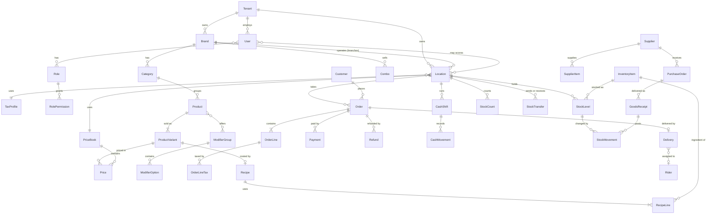

# Restoflux: Data Model

> **Status:** Phase 0 draft, awaiting review. **Last updated:** 2026-11-09.
> Read with [PRODUCT_SPEC.md](PRODUCT_SPEC.md) and [ARCHITECTURE.md](ARCHITECTURE.md). Field lists show the **key** fields only; the Prisma schema (in `api/prisma/schema/`) is the full truth once built. Decisions referenced as **D#** are in [DECISIONS.md](DECISIONS.md).

## 1. Conventions (apply to every table unless stated)

| Topic | Rule |
|---|---|
| **Primary key** | `id` UUIDv7 (`String @db.Uuid @default(uuid(7))`), time-ordered, unguessable, client-generatable (**D2**). Exceptions: reference tables keyed by code (`Currency`, `UnitOfMeasure`). |
| **Tenant** | `tenantId` on every business table, `NOT NULL`, indexed (first column of most composite indexes). Reference tables (`Currency`, `UnitOfMeasure`) have none. |
| **Location** | `locationId` on branch-level data (orders, payments, shifts, stock, counts, transfers, deliveries, roster). |
| **Timestamps** | `createdAt`, `updatedAt` as `timestamptz` (UTC). Transactions also carry `occurredAt` (device time) and `recordedAt` (server time). |
| **Business date** | `businessDate` (`@db.Date`) on orders, payments, refunds, shifts, cash movements, stock movements and adjustments; derived from the location's timezone and business-day start. |
| **Soft delete** | `deletedAt timestamptz?` on **master data** only (marked **SD** below). Uniqueness uses partial unique indexes `WHERE deletedAt IS NULL`. Ledgers and transactions are never soft-deleted. |
| **Money** | Amounts: integer minor units, field names end in `Minor`, plus `currencyCode` on transactional rows (**D1**). Rates, quantities and unit costs: `Decimal` (quantities/unit costs `Decimal(18,6)`, percentages `Decimal(7,4)`). |
| **Append-only** | `AuditLog`, `StockMovement`, `Payment`, `LoyaltyTransaction`, `OrderStatusEvent`, `LoginEvent`, `ApprovalRequest` (decisions) reject `UPDATE`/`DELETE` (trigger or grants). Corrections are new rows. |
| **Audit columns** | `createdById` (and `updatedById` on master data) reference `User`. |
| **Names** | Models `PascalCase`; tables `snake_case` plural via `@@map`; enums `PascalCase` with `UPPER_SNAKE` values. |
| **Cross-tenant safety** | Critical relations use **composite foreign keys** `(tenantId, parentId) → (tenantId, id)`; every such parent has `@@unique([tenantId, id])`. |

## 2. Overview (core relationships)

## 3. Entities by module

Legend: **SD** = soft delete. **Scoped** = tenant + location scoped by the client extension. `→` = foreign key.

### 3.1 Reference (no tenant)
| Entity | Key fields | Notes |
|---|---|---|
| `Currency` | `code` (PK, ISO 4217), `name`, `symbol`, `minorUnitExponent` | PKR 2, AED 2, USD 2, KWD 3, JPY 0. Read-only, seeded. |
| `UnitOfMeasure` | `code` (PK: g, kg, ml, l, pcs ...), `dimension` (WEIGHT/VOLUME/COUNT), `toBaseFactor` | Global conversions; per-item packaging is in `ItemPackaging`. |

### 3.2 Organization (L1)
| Entity | Key fields | Relations / rules |
|---|---|---|
| `Tenant` | `name`, `slug` (unique), `status` (ACTIVE/SUSPENDED), `baseCurrency`, `defaultLocale`, `authVersion`, `settings` JSON | `authVersion` bumps on any role/permission/access change (invalidates cached principals). `settings`: variance thresholds (default 2/5), cash tolerance, allowNegativeStock, fraud thresholds. |
| `Brand` **SD** | `name`, `slug` (**globally unique**, used by the storefront), `logoUrl`, `primaryColor`, `cuisine`, `isActive` | → Tenant. |
| `Location` **SD** | `type` (BRANCH/WAREHOUSE/CENTRAL_KITCHEN), `brandId?`, `code`, `name`, `countryCode`, `city`, `address` JSON, `lat/lng`, `phone`, `timezone` (IANA), `currencyCode`, `taxProfileId?`, `priceBookId?`, `businessDayStartTime`, `receiptHeader`, `receiptFooter`, `receiptTemplateId?`, `orderPrefix`, `acceptsOnlineOrders`, `isActive` | BRANCH requires brand, tax profile, price book (CHECK + service rule). Unique `(tenantId, code)`. One currency per location. |
| `LocationOpeningHour` | `locationId`, `weekday` 0-6, `opensAt`, `closesAt` | Several ranges per day; `closesAt < opensAt` means past midnight. |
| `DiningTable` **SD** | `locationId`, `name`, `seats`, `section`, `isActive` | Unique `(locationId, name)`. |
| `KitchenStation` | `locationId`, `key` (e.g. GRILL), `name`, `sortOrder`, `isActive` | Products route to stations by `stationKey`. |
| `TaxCategory` **SD** | `name` (Standard, Zero-rated, Exempt ...) | Assigned to products and combos. |
| `TaxProfile` **SD** | `name`, `countryCode`, `pricesIncludeTax`, `rounding` (HALF_UP) | Inclusive vs exclusive is a property of the profile. |
| `TaxRule` | `taxProfileId`, `taxCategoryId?` (null = all), `name`, `authorityCode` (SRB, PRA, FTA, TX ...), `ratePercent`, `isCompound`, `orderTypes[]` (empty = all), `sortOrder`, `validFrom/To` | Several rules per profile. Rates are data, never code. |
| `PaymentMethod` **SD** | `name`, `type` (CASH/CARD/WALLET/QR/BANK_TRANSFER/OTHER), `providerCode?`, `requiresReference`, `opensDrawer`, `isActive` | Wallets such as JazzCash/Easypaisa are rows, not code. |
| `LocationPaymentMethod` | `locationId`, `paymentMethodId`, `isEnabled`, `sortOrder` | Unique pair. |
| `ReceiptTemplate` **SD** | `name`, `config` JSON | Location header/footer override template text. |
| `ReasonCode` **SD** | `type` (VOID/REFUND/DISCOUNT/ADJUSTMENT/CASH_OUT), `code`, `name`, `requiresNote`, `isSystem` | Tenant-editable lists; adjustment system set: WASTE, EXPIRY, STAFF_MEAL, DAMAGE, THEFT, OTHER. |

### 3.3 Identity, access, approvals, audit, notifications (L1)
| Entity | Key fields | Relations / rules |
|---|---|---|
| `User` **SD** | `email` (**globally unique**, D5), `name`, `phone`, `passwordHash`, `posPinHash?`, `status`, `allLocations`, `lastLoginAt`, `locale` | Staff only. → Tenant. Customers are a different table. |
| `Role` **SD** | `name`, `description`, `isSystem`, `maxDiscountPercent` | Unique `(tenantId, name)`. System roles protected (Owner keeps `roles.manage`). |
| `RolePermission` | `roleId`, `permission` (string from catalog) | Unique pair; validated against the catalog in code. |
| `RoleLimit` | `roleId`, `currencyCode`, `voidLimitMinor`, `refundLimitMinor`, `poApprovalLimitMinor`, `adjustmentLimitMinor` | Unique `(roleId, currencyCode)`. No row = no limit authority. |
| `UserRole` | `userId`, `roleId` | Many-to-many; permissions are the union. |
| `UserLocation` | `userId`, `locationId` | Allowed branches (ignored when `allLocations`). |
| `Session` | `userId`, `audience` (STAFF/CUSTOMER), `refreshTokenHash`, `userAgent`, `ip`, `lastUsedAt`, `expiresAt`, `revokedAt` | Refresh token rotation; supports "sign out everywhere". |
| `LoginEvent` | `userId?`, `emailAttempted`, `success`, `failureReason?`, `ip`, `userAgent`, `occurredAt` | Append-only; shown in the user's login history. |
| `ApprovalRequest` | `type` (VOID/REFUND/DISCOUNT/STOCK_ADJUSTMENT/STOCK_COUNT/TRANSFER/PURCHASE_ORDER/CASH_OUT), `locationId?`, `entityType`, `entityId?`, `payload` JSON, `payloadHash`, `amountMinor?`, `currencyCode?`, `reason`, `requestedById`, `status` (PENDING/APPROVED/REJECTED/EXPIRED/CANCELLED/CONSUMED), `method` (INLINE_PIN/INBOX), `decidedById?`, `decidedAt?`, `decisionNote?`, `expiresAt`, `consumedAt?` | Retry-with-`approvalId` model (ARCHITECTURE 7.3). Inline PIN override creates an already-APPROVED row so there is one audit story. |
| `AuditLog` | `locationId?`, `actorUserId?`, `actorType`, `action`, `entityType`, `entityId`, `before` JSONB, `after` JSONB, `reason?`, `requestId`, `ip`, `userAgent`, `occurredAt` | Append-only. Indexes: `(tenantId, occurredAt desc)`, `(tenantId, entityType, entityId)`, `(tenantId, actorUserId, occurredAt)`. |
| `Notification` | `locationId?`, `userId?`, `requiredPermission?`, `type`, `severity`, `title`, `body`, `entityType?`, `entityId?`, `dedupeKey`, `readAt?` | Unique `(tenantId, dedupeKey)` prevents alert storms. Visible to the user, or to holders of `requiredPermission` in scope. |
| `NotificationPreference` | `userId`, `type`, `inApp`, `email` | Defaults per type. |

### 3.4 Catalog, menu and pricing (L2)
| Entity | Key fields | Relations / rules |
|---|---|---|
| `Category` **SD** | `brandId`, `parentId?`, `name`, `sortOrder`, `imageUrl` | Unique name per brand (partial). |
| `Product` **SD** | `brandId`, `categoryId`, `name`, `description`, `imageUrl`, `sku?`, `taxCategoryId`, `stationKey?`, `isActive`, `sortOrder` | Always has ≥ 1 `ProductVariant`. |
| `ProductVariant` **SD** | `productId`, `name` (Regular, Large ...), `sku?`, `isDefault`, `sortOrder` | Carries prices and the recipe. |
| `ModifierGroup` **SD** | `brandId`, `name`, `minSelect`, `maxSelect` | Required = `minSelect > 0`. |
| `ModifierOption` **SD** | `groupId`, `name`, `isDefault`, `sortOrder` | Price via `Price`; stock via `ModifierOptionUsage`. |
| `ProductModifierGroup` | `productId`, `modifierGroupId`, `sortOrder`, `minSelectOverride?`, `maxSelectOverride?` | Links a group to a product. |
| `Menu` **SD** | `brandId`, `name`, `isDefault`, `isActive` | A time-bound menu (Breakfast, Lunch/Dinner). |
| `MenuSchedule` | `menuId`, `weekdays[]`, `startsAt`, `endsAt` (null = all day) | Evaluated in the branch timezone. |
| `MenuProduct` | `menuId`, `productId`, `sortOrder` | Unique pair; products and combos may be in several menus (combos via `MenuCombo`, same shape). |
| `Combo` **SD** | `brandId`, `name`, `description`, `imageUrl`, `taxCategoryId`, `isActive`, `startsAt?`, `endsAt?` | Replaces the old `Deal`. |
| `ComboSlot` | `comboId`, `name`, `quantity`, `sortOrder` | A fixed bundle has slots with one option; a choice combo has several. |
| `ComboSlotOption` | `slotId`, `variantId`, `isDefault` | Up-charge through `Price` (`comboSlotOptionId`). |
| `PriceBook` **SD** | `brandId?`, `name`, `currencyCode`, `isDefault` | One per currency/region, assigned to locations. |
| `Price` | exactly one target: `variantId` / `modifierOptionId` / `comboId` / `comboSlotOptionId`; exactly one scope: `priceBookId` or `locationId`; `channel?`, `amountMinor`, `compareAtMinor?`, `currencyCode`, `validFrom?`, `validTo?` | Resolution: location+channel → location → book+channel → book. Currency must equal the book/location currency. Two CHECKs + partial unique indexes. |
| `LocationAvailability` | exactly one of `productId` / `comboId` / `modifierOptionId`; `locationId`, `isListed`, `isAvailable` (86), `soldOutUntil?`, `updatedById` | Per-branch overrides; unique per (location, target). |

### 3.5 Customers and marketing (L2; basic customer in Phase 3, rest in Phase 7)
| Entity | Key fields | Relations / rules |
|---|---|---|
| `Customer` **SD** | `name`, `phone?`, `email?`, `passwordHash?` (storefront login), `marketingConsent`, `birthday?`, `tags[]`, `isBlocked`, `notes` | Unique `(tenantId, email)` and `(tenantId, phone)` (partial). Customer tokens use audience CUSTOMER. |
| `CustomerAddress` | `customerId`, `label`, `line1`, `line2`, `city`, `area`, `postalCode`, `lat/lng`, `instructions`, `isDefault` | Several per customer. |
| `Promotion` **SD** | `brandId?`, `name`, `kind` (PERCENT_OFF/AMOUNT_OFF/FREE_ITEM), `value`, `minOrderMinor?`, `maxDiscountMinor?`, `priority`, `isStackable`, `startsAt/endsAt`, `weekdays[]`, `timeStart/End`, `channels[]`, `orderTypes[]`, `isActive` | Automatic or coupon-driven. |
| `PromotionScope` | `promotionId`, `scopeType` (BRAND/LOCATION/CATEGORY/PRODUCT/VARIANT), `refId` | Polymorphic by type; integrity validated in the service. |
| `Coupon` | `promotionId`, `code` (unique per tenant), `usageLimitTotal?`, `usageLimitPerCustomer?`, `usedCount`, `validFrom/To`, `isActive` | Redemption increments `usedCount` atomically (`UPDATE ... WHERE usedCount < limit`). |
| `CouponRedemption` | `couponId`, `orderId`, `customerId?`, `redeemedAt` | Unique `(couponId, orderId)`. |
| `LoyaltyProgram` / `LoyaltyRule` | program: `brandId?`, `name`, `expiryDays?`, `isActive`; rule: `programId`, `currencyCode`, `earnPointsPerMajorUnit`, `redeemMinorPerPoint`, `minRedeemPoints` | Rules are per currency. |
| `LoyaltyAccount` | `customerId`, `programId`, `pointsBalance` | Balance maintained with the ledger; unique pair. |
| `LoyaltyTransaction` | `accountId`, `type` (EARN/REDEEM/EXPIRE/ADJUST), `points` (signed), `orderId?`, `note`, `occurredAt`, `createdById?` | Append-only; balance = sum. |
| `CustomerFeedback` | `locationId`, `orderId?`, `customerId?`, `rating` 1-5, `comment`, `response?`, `respondedById?`, `respondedAt?` | Staff reply. |

### 3.6 Orders, POS, payments, cash (L3)
| Entity | Key fields | Relations / rules |
|---|---|---|
| `Aggregator` **SD** | `name`, `commissionPercent`, `isActive` | Foodpanda, Uber Eats, DoorDash as tenant data. |
| `Order` | `id` (client UUID), `brandId`, `locationId`, `businessDate`, `orderType` (DINE_IN/TAKEAWAY/DELIVERY), `channel` (POS/WEB/ANDROID/IOS/PHONE/AGGREGATOR), `aggregatorId?`, `aggregatorRef?`, `displayNumber?`, `provisionalNumber?`, `status`, `paymentStatus` (UNPAID/PARTIAL/PAID/REFUNDED/PARTIALLY_REFUNDED), `customerId?`, customer name/phone snapshot, `tableId?`, `covers?`, `deliveryAddress` JSON?, `deliveryFeeMinor`, `currencyCode`, `subtotalMinor`, `discountMinor`, `taxMinor`, `tipMinor`, `totalMinor`, `paidMinor`, `refundedMinor`, `pricesIncludeTax`, `notes`, `occurredAt`, `placedAt`, `completedAt?`, `cancelledAt?`, `cancelReasonId?`, `createdById?`, `cashShiftId?`, `legacyOrderId?` | Unique `(locationId, businessDate, displayNumber)`. Status: OPEN, PENDING, CONFIRMED, PREPARING, READY, OUT_FOR_DELIVERY, COMPLETED, CANCELLED. Totals are snapshots. |
| `OrderLine` | `orderId`, `parentLineId?`, `kind` (ITEM/COMBO/COMBO_ITEM), `variantId?`, `comboId?`, `nameSnapshot`, `variantNameSnapshot`, `quantity`, `unitPriceMinor`, `modifiersTotalMinor`, `lineSubtotalMinor`, `discountMinor`, `taxMinor`, `lineTotalMinor`, `stationKey?`, `status` (NEW/PREPARING/READY/SERVED/VOIDED), `sentToKitchenAt?`, `readyAt?`, `voidedAt?`, `voidedById?`, `voidReasonId?`, `voidApprovalId?`, `notes` | Combo children link via `parentLineId` so each part consumes stock. Drives the KDS. |
| `OrderLineModifier` | `lineId`, `optionId`, `nameSnapshot`, `priceMinor`, `quantity` | Snapshot. |
| `OrderLineTax` | `lineId`, `ruleId?`, `ruleNameSnapshot`, `authorityCode`, `ratePercent`, `baseMinor`, `taxMinor`, `isInclusive` | The stored tax breakdown (receipts, tax reports). |
| `OrderDiscount` | `orderId`, `lineId?`, `source` (MANUAL/COUPON/PROMOTION), `valueType` (PERCENT/AMOUNT), `value`, `amountMinor`, `reasonId?`, `couponId?`, `promotionId?`, `appliedById`, `approvalId?` | Allocated to lines before tax. |
| `OrderStatusEvent` | `orderId`, `fromStatus`, `toStatus`, `at`, `byUserId?`, `note` | Append-only; gives prep-time metrics. |
| `Payment` | `id` (client UUID), `orderId`, `locationId`, `businessDate`, `paymentMethodId`, `amountMinor` (applied), `tenderedMinor`, `changeMinor`, `tipMinor`, `currencyCode`, `reference?`, `status` (CAPTURED/VOIDED), `cashShiftId?`, `receivedById`, `occurredAt` | Append-only. Split payments = several rows. |
| `Refund` / `RefundLine` | refund: `orderId`, `locationId`, `businessDate`, `amountMinor`, `restock`, `reasonId`, `paymentMethodId`, `cashShiftId?`, `requestedById`, `approvedById?`, `approvalId?`; line: `refundId`, `orderLineId`, `quantity`, `amountMinor` | Reasons mandatory; over-limit needs approval. |
| `OrderSequence` | `locationId`, `businessDate`, `lastNumber` | PK `(locationId, businessDate)`; atomic increment assigns `displayNumber`. |
| `CashRegister` **SD** | `locationId`, `name`, `isActive` | A drawer/terminal. |
| `CashShift` | `locationId`, `registerId?`, `businessDate`, `openedById`, `openedAt`, `openingFloatMinor`, `closedById?`, `closedAt?`, `expectedCashMinor?`, `countedCashMinor?`, `varianceMinor?`, `isBlindClose`, `status` (OPEN/CLOSED), `currencyCode`, `notes` | One open shift per register. |
| `CashMovement` | `shiftId`, `type` (CASH_IN/CASH_OUT/PAID_OUT/SAFE_DROP), `amountMinor`, `reasonId`, `note`, `approvalId?`, `createdById`, `occurredAt` | Append-only. |
| `ZReport` | `locationId`, `businessDate`, `scope` (SHIFT/DAY), `cashShiftId?`, `generatedById`, `generatedAt`, `data` JSON, `version` | Immutable snapshot of totals by method, tax, discounts, voids, refunds, cash variance. |

### 3.7 Inventory (L4)
| Entity | Key fields | Relations / rules |
|---|---|---|
| `ItemCategory` **SD** | `name` | Optional grouping (Meat, Dairy, Dry goods). |
| `InventoryItem` **SD** | `name`, `sku?`, `kind` (RAW/PREP/PACKAGING), `baseUnit` → UnitOfMeasure, `categoryId?`, `trackBatches`, `shelfLifeDays?`, `referenceCost?` (used until the first purchase), `isActive` | Prep items are produced by a `Recipe`. |
| `ItemPackaging` | `itemId`, `name` (case, sack), `baseQty`, `barcode?`, `isPurchaseUnit` | Case = 24 pieces, sack = 25 kg. |
| `Recipe` | exactly one target: `variantId` or `prepItemId`; `version`, `yieldQty`, `isActive`, `effectiveFrom`, `notes` | One active recipe per target (partial unique). Sub-recipes work through prep items. |
| `RecipeLine` | `recipeId`, `itemId`, `qty` (base unit), `enteredUnit`, `wastePercent`, `sortOrder` | Waste % models trim loss. |
| `ModifierOptionUsage` | `optionId`, `itemId`, `qty` | Stock used by an add-on (extra cheese). |
| `StockLevel` | PK `(locationId, itemId)`, `onHandQty`, `avgCost`, `parQty?`, `reorderPointQty?`, `maxQty?`, `lastCountedAt?` | Maintained by atomic SQL in the same transaction as the movement. |
| `StockMovement` | `locationId`, `itemId`, `type`, `qty` (signed, ≠ 0), `unitCost`, `valueMinor`, `currencyCode`, `reasonId?`, `refType`, `refId`, `batchId?`, `businessDate`, `occurredAt`, `recordedAt`, `createdById?`, `note` | Append-only ledger. Types: PURCHASE_RECEIPT, SALE_CONSUMPTION, SALE_REVERSAL, TRANSFER_OUT, TRANSFER_IN, PRODUCTION_IN, PRODUCTION_OUT, ADJUSTMENT, WASTE, EXPIRY, STAFF_MEAL, DAMAGE, THEFT, COUNT_VARIANCE, RETURN_TO_SUPPLIER, OPENING_BALANCE. |
| `StockBatch` | `locationId`, `itemId`, `batchNo`, `receivedAt`, `expiryDate?`, `qtyOnHand`, `unitCost`, `supplierId?` | Optional (FEFO consumption). |
| `StockCount` | `locationId`, `type` (FULL/PARTIAL/CYCLE), `name`, `scheduledFor`, `status` (SCHEDULED/IN_PROGRESS/SUBMITTED/APPROVED/CANCELLED), `isBlind`, `startedAt`, `submittedAt?`, `submittedById?`, `approvedAt?`, `approvedById?`, `lockedAt?` | Locked once submitted; approval posts COUNT_VARIANCE movements. |
| `StockCountSection` | `countId`, `name`, `assignedToId?`, `status` | Multi-person counting by storage area. |
| `StockCountLine` | `countId`, `itemId`, `expectedQty` (snapshot), `countedQty?`, `varianceQty?`, `unitCostSnapshot`, `varianceValueMinor?` | Counted = sum of entries (or reconciled). |
| `StockCountEntry` | `lineId`, `sectionId?`, `countedById`, `qty`, `enteredUnit`, `countedAt`, `note` | Several people may enter parts of one line. |
| `StockAdjustment` / `StockAdjustmentLine` | adjustment: `locationId`, `reasonId`, `note` (required), `status` (POSTED/PENDING_APPROVAL/REJECTED), `totalValueMinor`, `approvalId?`, `businessDate`; line: `itemId`, `qty` (signed), `unitCost`, `valueMinor`, `batchId?` | Waste, expiry, staff meal, damage, theft; value-based approval. |
| `StockTransfer` / `StockTransferLine` | transfer: `fromLocationId`, `toLocationId`, `number`, `status` (REQUESTED/APPROVED/DISPATCHED/RECEIVED/CANCELLED/REJECTED), requested/approved/dispatched/received by + at, `note`; line: `itemId`, `requestedQty`, `dispatchedQty`, `receivedQty`, `unitCost` (at dispatch), `varianceQty` | TRANSFER_OUT at dispatch, TRANSFER_IN at receive; in-transit is dispatched-not-received. |
| `ProductionRun` | `locationId` (central kitchen), `prepItemId`, `recipeId`, `plannedQty`, `expectedYieldQty`, `producedQty`, `status`, `producedAt`, `producedById`, `batchId?`, `note` | PRODUCTION_OUT (ingredients) and PRODUCTION_IN (prep item at actual yield). |
| `StockSnapshot` | `locationId`, `itemId`, `businessDate`, `qty`, `avgCost` | Nightly; historical valuation and fast reports. |

### 3.8 Purchasing and suppliers (L4)
| Entity | Key fields | Relations / rules |
|---|---|---|
| `Supplier` **SD** | `name`, `code`, `contactName`, `phone`, `email`, `address`, `taxId`, `paymentTermsDays`, `currencyCode`, `notes`, `isActive` | Purchasing is in the receiving location's currency (no FX, D18). |
| `SupplierItem` | `supplierId`, `itemId`, `supplierSku`, `packagingId?`, `packName`, `packBaseQty`, `isPreferred`, `leadTimeDays`, `minOrderPacks?`, `isActive` | Unique `(supplierId, itemId, packName)`. |
| `SupplierItemPrice` | `supplierItemId`, `priceMinor` (per pack), `currencyCode`, `effectiveFrom`, `source` (MANUAL/RECEIPT/INVOICE), `refId?`, `createdById` | History powers price-creep reports. |
| `PurchaseOrder` | `locationId` (deliver to), `supplierId`, `number`, `status` (DRAFT/PENDING_APPROVAL/APPROVED/SENT/PARTIALLY_RECEIVED/RECEIVED/CLOSED/CANCELLED/REJECTED), `orderedAt`, `expectedAt`, `subtotalMinor`, `taxMinor`, `totalMinor`, `currencyCode`, `approvalId?`, `createdById`, `approvedById?`, `notes` | Approval limit per role and currency. |
| `PurchaseOrderLine` | `poId`, `itemId`, `supplierItemId?`, `packName`, `packBaseQty`, `orderedPacks`, `receivedPacks`, `unitPriceMinor`, `taxPercent?`, `lineTotalMinor` | |
| `GoodsReceipt` / `GoodsReceiptLine` | receipt: `locationId`, `supplierId`, `poId?`, `number`, `deliveryNoteNo`, `receivedAt`, `receivedById`, `status` (DRAFT/POSTED), `totalMinor`; line: `poLineId?`, `itemId`, `receivedBaseQty`, `rejectedBaseQty`, `rejectReason?`, `unitPriceMinorPerPack`, `expectedPriceMinor?`, `priceVarianceFlag`, `unitCost`, `batchNo?`, `expiryDate?` | Posting creates PURCHASE_RECEIPT movements and updates average cost; price differences flagged. |
| `SupplierInvoice` | `supplierId`, `locationId?`, `invoiceNo`, `invoiceDate`, `dueDate`, `subtotalMinor`, `taxMinor`, `totalMinor`, `currencyCode`, `status` (OPEN/PARTIALLY_PAID/PAID/DISPUTED/VOID), `matchStatus` (UNMATCHED/MATCHED/MISMATCH) | Unique `(supplierId, invoiceNo)`. |
| `SupplierInvoiceReceipt` | `invoiceId`, `receiptId` | Links invoices to receipts (basic three-way match). |
| `SupplierPayment` / `SupplierPaymentAllocation` | payment: `supplierId`, `paidAt`, `amountMinor`, `method`, `reference`; allocation: `paymentId`, `invoiceId`, `amountMinor` | Outstanding = invoices − allocations − credit notes. |
| `SupplierCreditNote` | `supplierId`, `receiptId?`, `amountMinor`, `reason`, `status`, `appliedToInvoiceId?` | Returns and rejected goods. |

### 3.9 Delivery (L3)
| Entity | Key fields | Relations / rules |
|---|---|---|
| `Rider` **SD** | `userId?`, `employeeId?`, `name`, `phone`, `locationId?`, `vehicleType`, `status` (AVAILABLE/BUSY/OFFLINE), `isActive` | |
| `DeliveryZone` | `locationId`, `name`, `area` JSON (postcodes or polygon), `feeMinor`, `minOrderMinor`, `freeAboveMinor?`, `estimatedMinutes`, `isActive` | |
| `Delivery` | `orderId` (unique), `locationId`, `riderId?`, `zoneId?`, `status` (PENDING/ASSIGNED/PICKED_UP/DELIVERED/FAILED/RETURNED), `addressSnapshot` JSON, `feeMinor`, `cashToCollectMinor`, `cashCollectedMinor?`, `assignedAt?`, `pickedUpAt?`, `deliveredAt?`, `failureReason?`, `settledAt?`, `settlementShiftId?` | COD cash flows into the rider settlement and the branch cash report. |

### 3.10 Staff (L2)
| Entity | Key fields | Relations / rules |
|---|---|---|
| `Employee` **SD** | `userId?`, `locationId` (primary), `name`, `phone`, `positionTitle`, `hourlyRateMinor?`, `currencyCode`, `hiredAt`, `endedAt?`, `isActive` | Links to `User` when the person logs in. |
| `RosterShift` | `employeeId`, `locationId`, `startsAt`, `endsAt`, `positionTitle?`, `status` (DRAFT/PUBLISHED), `note` | No overlapping shifts per employee (exclusion rule in service). Named to avoid clashing with `CashShift`. |
| `TimeEntry` | `employeeId`, `locationId`, `clockInAt`, `clockOutAt?`, `source` (POS/MANUAL), `editedById?`, `note` | Hours worked; feeds the labour placeholder KPI. |

### 3.11 Reporting support (L5)
| Entity | Key fields | Notes |
|---|---|---|
| `DailySalesSummary` | `locationId`, `businessDate`, `channel?`, `orderType?`, `ordersCount`, `grossMinor`, `discountMinor`, `taxMinor`, `netMinor`, `voidsMinor`, `refundsMinor` | **Only if** measured need (ARCHITECTURE 12); maintained in the source transaction. |
| `FxRate` | `fromCurrency`, `toCurrency`, `rate`, `asOfDate` | Manually maintained (D18); used only for consolidated reporting views. |

## 4. Enumerations

`Role`-like enums are **not** used for roles (they are tenant data). Fixed enums: `OrderType` (DINE_IN, TAKEAWAY, DELIVERY) · `OrderChannel` (POS, WEB, ANDROID, IOS, PHONE, AGGREGATOR; extends today's enum) · `OrderStatus` (OPEN, PENDING, CONFIRMED, PREPARING, READY, OUT_FOR_DELIVERY, COMPLETED, CANCELLED) · `PaymentStatus` · `LineStatus` · `LocationType` · `PaymentMethodType` · `ApprovalType` · `ApprovalStatus` · `StockMovementType` · `CountType` / `CountStatus` · `TransferStatus` · `PurchaseOrderStatus` · `DeliveryStatus` · `NotificationType` / `Severity` · `ReasonType`.

## 5. Constraints and indexes that matter

**Indexes (beyond the obvious foreign keys)**
- `Order`: `(tenantId, locationId, businessDate)`, `(tenantId, locationId, status)`, `(tenantId, customerId)`, unique `(locationId, businessDate, displayNumber)`.
- `Payment`: `(tenantId, locationId, businessDate)`, `(orderId)`. `Refund`: same pattern.
- `StockMovement`: `(tenantId, locationId, itemId, occurredAt)`, `(tenantId, refType, refId)`, `(tenantId, locationId, businessDate, type)`.
- `AuditLog` and `Notification`: see 3.3.
- Reports rely on `(tenantId, locationId, businessDate)` leading indexes everywhere a report groups by day.

**Partial unique indexes (soft delete):** `Category(brandId, lower(name))`, `Product(brandId, lower(name))` where applicable, `Location(tenantId, code)`, `Role(tenantId, name)`, `Customer(tenantId, email)`, `Customer(tenantId, phone)`, `Supplier(tenantId, code)`, `InventoryItem(tenantId, sku)`, one active `Recipe` per target.

**CHECK constraints:** `Price` has exactly one target and exactly one scope; `Recipe` has exactly one target; `LocationAvailability` has exactly one target; `StockMovement.qty <> 0`; `Payment.amountMinor > 0`; BRANCH locations have brand, tax profile and price book; `Currency.minorUnitExponent BETWEEN 0 AND 4`; `OrderLine.quantity > 0`.

**Composite foreign keys (cross-tenant safety):** `OrderLine→Order`, `OrderLineTax→OrderLine`, `Payment→Order`, `Refund→Order`, `CashMovement→CashShift`, `StockMovement→InventoryItem/Location`, `StockLevel→InventoryItem/Location`, `RecipeLine→Recipe/InventoryItem`, `Price→ProductVariant/PriceBook`, `UserRole→User/Role`, `UserLocation→User/Location`, `PurchaseOrderLine→PurchaseOrder`, `GoodsReceiptLine→GoodsReceipt`.

**Append-only enforcement:** triggers (or revoked grants) on `audit_logs`, `stock_movements`, `payments`, `loyalty_transactions`, `order_status_events`, `login_events`.

## 6. Migration plan from the current schema

### 6.1 What exists today
`User(id Int, email, passwordHash, name, role CUSTOMER|ADMIN)`, `Category`, `MenuItem(priceCents, imageUrl, available)`, `Order(userId, status, channel, totalCents, notes)`, `OrderItem(unitPriceCents snapshot)`, `Deal`, `DealItem`, `OrderDeal(dealName, unitPriceCents snapshots)`; Neon Postgres, 3 migrations, `Int` ids, integer minor-unit money (paisa).

### 6.2 Mapping (old → new)
| Current | Becomes | Notes |
|---|---|---|
| `User` with role `ADMIN` | `User` (staff) + `UserRole(Owner)` + `allLocations = true` in the default tenant | Same email and bcrypt hash, so admins keep their passwords. |
| `User` with role `CUSTOMER` | `Customer` | Same hash, so customers keep their passwords. Moves in Phase 3. |
| `Category` | `Category` (+ `brandId`) | |
| `MenuItem` | `Product` + one `ProductVariant` ("Regular") + `Price` in the default price book (`priceCents` is already minor units) + `LocationAvailability` (`available`) for the default branch | `imageUrl` carries over. |
| `Deal` / `DealItem` | `Combo` + one `ComboSlot` per `DealItem` (one fixed `ComboSlotOption`, quantity preserved) + `Price` (`dealPriceCents`, `compareAtMinor = originalPriceCents`) | `isActive`, `startsAt`, `endsAt` carry over. |
| `Order` | `Order` | `userId → customerId`; `channel` unchanged (WEB/POS/ANDROID/IOS); `orderType = TAKEAWAY` (assumption D22: the old app had no order types); status names unchanged; `totalCents → totalMinor`, `taxMinor = 0`; `businessDate` = date of `createdAt` in `Asia/Karachi`; `currencyCode = PKR`; default location. Payment: the old app had no payments, so `COMPLETED` orders get one synthetic `Payment` on a "Legacy / unspecified" method (type OTHER, flagged by `legacyOrderId`), others stay UNPAID. |
| `OrderItem` | `OrderLine` (kind ITEM) | `variantId` via `legacy_id_map`; `nameSnapshot` from the menu item name at migration time (the old table had no name snapshot); `unitPriceCents` snapshot kept. |
| `OrderDeal` | `OrderLine` (kind COMBO) | `dealName` becomes `nameSnapshot`; `comboId` via the map; `unitPriceCents` kept. |
| `/api/stats` | `reports.sales` (Phase 6) | Same numbers reproduced and compared. |

### 6.3 Technique
1. **Expand, migrate, contract.** New tables are added first; data is copied by idempotent SQL; the app switches; old tables are archived (renamed `_archived_*`) one release later, then dropped.
2. **Legacy models keep their table names.** In Phase 1 the Prisma *models* for the old tables are renamed `LegacyUser`, `LegacyCategory`, `LegacyMenuItem`, `LegacyOrder`, `LegacyOrderItem`, `LegacyDeal`, `LegacyDealItem`, `LegacyOrderDeal` with `@@map` to the **existing** table names ("User", "Order", ...). The new models take the natural names and map to new snake_case tables (`users`, `orders`, ...). Postgres treats `"User"` and `users` as different tables, so **no data moves in Phase 1**; only code references are renamed.
3. **`legacy_id_map(entity, legacyId int, newId uuid)`** records every copied row so old ids can be translated (bridge, reconciliation, rollback analysis).
4. **Neon branch rehearsal:** before applying a migration to the main branch, create a Neon branch of the real data, run the migration and the reconciliation queries there, then repeat on main. Rollback = restore from the pre-migration branch (documented per phase).
5. **Reconciliation queries (must be equal before and after):** row counts per entity; `SUM(totalCents)` of orders vs `SUM(totalMinor)`; per-status order counts; every legacy menu item mapped to exactly one variant with exactly one price; every legacy deal total preserved.
6. **Default tenant:** created in Phase 1 (`slug: "default"`, brand "Default", branch "Main Branch": PKR, `Asia/Karachi`, a zero-rate tax profile, price book "Default PKR", cash/card/wallet payment methods, default roles). The demo tenant from the new seed is a separate tenant.

### 6.4 Phase by phase
| Phase | Data actions | App impact |
|---|---|---|
| **1** | Create platform tables, the default tenant and its roles; create staff `User`s from legacy admins; rename legacy models in code (tables untouched); add `Currency`/`UnitOfMeasure` seeds | Storefront and old admin keep working on legacy routes and legacy auth. New admin app uses new auth. Coverage test lists legacy models in an **allow-list that expires in Phase 3**. |
| **2** | Copy categories, menu items, deals into the new catalog (idempotent SQL + id map); **expand** `legacy_order_items` (`menuItemId` becomes nullable; add `variantId`, `nameSnapshot`) so the **compatibility bridge** can keep storing storefront orders while the catalog's source of truth is the new one | Storefront reads the new catalog via public endpoints; its checkout still posts to a legacy-shaped route that maps variants/combos back. Old admin menu/deals pages in `web/` are removed (new admin app replaces them). |
| **3** | Copy customers, orders, lines, deal lines (+ synthetic legacy payments); reconcile totals to the cent; switch storefront to the new order and customer endpoints; delete legacy routes, models and tests; rename legacy tables to `_archived_*` | Bridge removed. Old admin orders/board pages in `web/` removed. |
| **4 to 8** | New tables only (no legacy data) plus seed data | None for existing data. |

**Bridge risk (flagged for your review, D20):** the window between Phase 2 and Phase 3 is the only place where two sources of truth exist (new catalog, legacy orders). It is kept deliberately thin and read-only for catalog data. The alternative is to build a minimal version of the new order tables in Phase 2; it removes the bridge but pulls scope forward.

### 6.5 What happens to existing code and tests
| Current | Fate |
|---|---|
| `src/config/env.ts` | Moves to `core/config`, extended with new variables |
| `src/lib/jwt.ts`, `src/middleware/auth.ts` | Replaced by `core/auth` + `core/rbac`; legacy copies stay in `legacy/` until Phase 3 |
| `src/middleware/error.ts` | Replaced by `core/http` (new envelope); legacy keeps the old format |
| `src/routes/*` | Moved to `legacy/` (Phase 1), replaced module by module, deleted in Phase 3 |
| `scripts/seed.ts`, `create-admin.ts` | `create-tenant` and the new demo seed replace them; old scripts retired in Phase 3 |
| `tests/*` | Live under `tests/legacy/` and are deleted **with** their routes; every phase ends with all tests green |
| `web/` | Remains the storefront; API client, catalog and order calls updated per phase; old admin pages removed as replaced |

### 6.6 Seed plan (new demo tenant)
Order of generation: currencies/units → tenant, brands, locations, tax profiles, price books, payment methods → roles, users → catalog, menus, prices, availability → inventory items, recipes, par levels → suppliers, supplier items, 90 days of purchase orders/receipts/invoices/payments → opening stock → 90 days of orders by channel with payments, discounts, coupons, voids, refunds, shifts and drawer counts → waste adjustments, weekly counts with injected variances, transfers, production runs → customers, loyalty → deliveries, riders, roster. Generated in memory with a seeded PRNG, inserted with chunked `createMany`, keyed by tenant slug `demo`, with `--reset` and `--small` flags. Running it twice changes nothing.

---

## 7. Phase 1: as built (deltas from the design above)

**Migration:** `20261109095925_phase1_tenancy_iam` (additive: 26 new tables plus hand-written SQL; no legacy table is touched). The legacy tables keep their names; only their Prisma model names changed to `Legacy*`.

**New tables:** `currencies`, `tenants`, `brands`, `locations`, `location_opening_hours`, `dining_tables`, `kitchen_stations`, `tax_categories`, `tax_profiles`, `tax_rules`, `payment_methods`, `location_payment_methods`, `price_books`, `reason_codes`, `users`, `roles`, `role_permissions`, `role_limits`, `user_roles`, `user_locations`, `sessions`, `login_events`, `approval_requests`, `audit_logs`, `notifications`, `notification_preferences`.

**Differences from the entity tables in section 3**
- `Tenant.authVersion` exists as designed; users have **no** per-user version (a tenant-wide bump after any access change is enough and simpler).
- `Role` gained `isOwner` and `unlimitedLimits` (the owner and head-office roles bypass amount thresholds; every use is still audited).
- `User` gained `pinFailedAttempts` and `pinLockedUntil` (PIN lockout after 5 failures for 15 minutes).
- `Session` gained `prevRefreshTokenHash` (replay detection after rotation).
- `TaxProfile` has no `rounding` column: rounding is fixed to half-up in code until a second mode is needed.
- `Location.latitude/longitude` are `Decimal(9,6)`; `Location.businessDayStartTime` and opening hours are `"HH:MM"` strings.
- `Notification.type` is a free-form string (new notification kinds need no migration); `ApprovalRequest.requestedById/decidedById` are plain FKs; `AuditLog.actorUserId` has **no** foreign key (the log must survive user deletion).
- **Deferred:** `ReceiptTemplate` (Phase 3), `UnitOfMeasure` (Phase 4), `Price`/catalog tables (Phase 2). `PriceBook` exists with only name, currency and brand.

**Constraints implemented**
- *Composite (tenant-safe) foreign keys:* `LocationOpeningHour`, `DiningTable`, `KitchenStation`, `LocationPaymentMethod`, `TaxRule`, `RolePermission`, `RoleLimit`, `UserRole`, `UserLocation`, `Session`.
- *Partial unique indexes (live rows only):* brand name, location code, table name per location, tax category / tax profile / payment method / price book / role name (case-insensitive), reason code per type. Globally unique: `brands.slug`, `users.email`, `tenants.slug`.
- *CHECK constraints:* a BRANCH must have a brand; currency exponent 0 to 4; user email stored lower-case; role discount 0 to 100; role limits non-negative; weekday 0 to 6; tax rate 0 to 100.
- *Append-only triggers:* `audit_logs` and `login_events` reject UPDATE and DELETE unless the transaction sets `app.allow_purge = 'on'` (only the purge helper does).

**Data migration performed by scripts (not by the SQL migration):** `npm run bootstrap:default-tenant` creates the `default` tenant (brand, "Main Branch", zero-rate tax profile, PKR price book, roles, payment methods) and copies each legacy ADMIN into a staff Owner with the same email and password hash. It is idempotent and changes nothing legacy.

---

## 8. Phase 2a: as built (deltas from section 3.4)
- `Category.parentId` was not built (categories are flat). `Product` gained `tags[]` (dietary and display indicators) and `allergens[]`; `stationKey` is a free key matched to `KitchenStation.key`.
- `Menu` has no `isDefault`-with-schedule rule beyond: default menu with no schedule rows is always served. `MenuSchedule.startsAt/endsAt` are "HH:MM" strings (null both = all day), weekdays are `Int[]` (0 = Sunday).
- `Price`: `validFrom` / `validTo` were NOT built (promotions in Phase 7 handle time-limited prices). `channel` uses a new enum `PriceChannel` (POS, WEB, ANDROID, IOS, PHONE, AGGREGATOR); Phase 3 reuses it for orders. Uniqueness is two partial unique indexes (channel null / not null) over COALESCE of the four targets and two scopes. `currencyCode` is stamped by the API from the price book or branch.
- `LocationAvailability` is location-scoped (a branch-limited user sees and changes only their branches). `Price` is location-scoped when `locationId` is set (branch overrides) and company-wide otherwise.
- `ModifierOption.isDefault` marks a preselected option; option and variant removal is a soft delete.

---

## 9. Phase 3: as built (deltas from section 3.6)
- `Order.channel` reuses the `PriceChannel` enum (POS, WEB, ANDROID, IOS, PHONE, AGGREGATOR). The aggregator is two text columns (`aggregatorName`, `aggregatorRef`); the `Aggregator` table with commission comes with Phase 8. No `customerId` yet (name and phone snapshot only). No service-charge column.
- `OrderLineTax` stores `rateBp` (basis points) instead of a decimal rate. `OrderDiscount.value` is basis points for PERCENT and minor units for AMOUNT.
- `Refund` is order-level (amount, method, reason); line-level refunds with restock arrive with Phase 4.
- One OPEN `CashShift` per register is a partial unique index. `Payment.status` exists but payments are never voided (a mistake is a refund).
- The Prisma enum for order status is mapped to the database type `order_status`; the legacy enum keeps the old type name `OrderStatus`.
- `PlatformAuditLog.tenantId` was renamed `targetTenantId` so that "a column named tenantId means tenant-owned" holds everywhere.

## 10. Back-office tables built in Phases 4 to 8 (what is actually in the database)

Where §3 sketched these modules, this is what was built. All are tenant scoped; the ones with a `locationId` are also branch scoped (declared in `api/src/core/db/meta.ts`, checked by the tenancy coverage test).

| Area | Tables | Notes |
|---|---|---|
| Inventory | `inventory_items`, `stock_levels`, `stock_movements`, `recipes`, `recipe_lines`, `stock_counts`, `stock_count_lines`, `stock_transfers`, `stock_transfer_lines`, `production_runs` | Quantities `Decimal(14,3)`, costs `Decimal(18,6)` per base unit. `stock_movements` is append-only (trigger). One recipe per menu variant or prep item (CHECK exactly one target). Transfers carry two location columns and are not branch scoped; the routes check the person can see either end. |
| Purchasing | `suppliers`, `supplier_items`, `purchase_orders`, `purchase_order_lines`, `goods_receipts`, `goods_receipt_lines`, `supplier_invoices`, `supplier_payments` | Prices are per pack in minor units; `supplier_payments` is append-only; an invoice cannot be paid beyond its total (CHECK). |
| Customers and marketing | `customers`, `loyalty_programs`, `loyalty_transactions`, `coupons`, `promotions`, `feedback` | Customers are matched by normalised phone (partial unique index). Percent values are stored as basis points. `loyalty_transactions` is append-only. `order_discounts.offerId` records the coupon or promotion behind a discount. |
| Delivery and staff | `delivery_zones`, `riders`, `delivery_assignments`, `employees`, `roster_shifts`, `time_entries`, `receipt_templates` | One open time entry per employee (partial unique index). Roster times are `HH:MM` strings in the branch's own time; an end earlier than the start means past midnight. |
